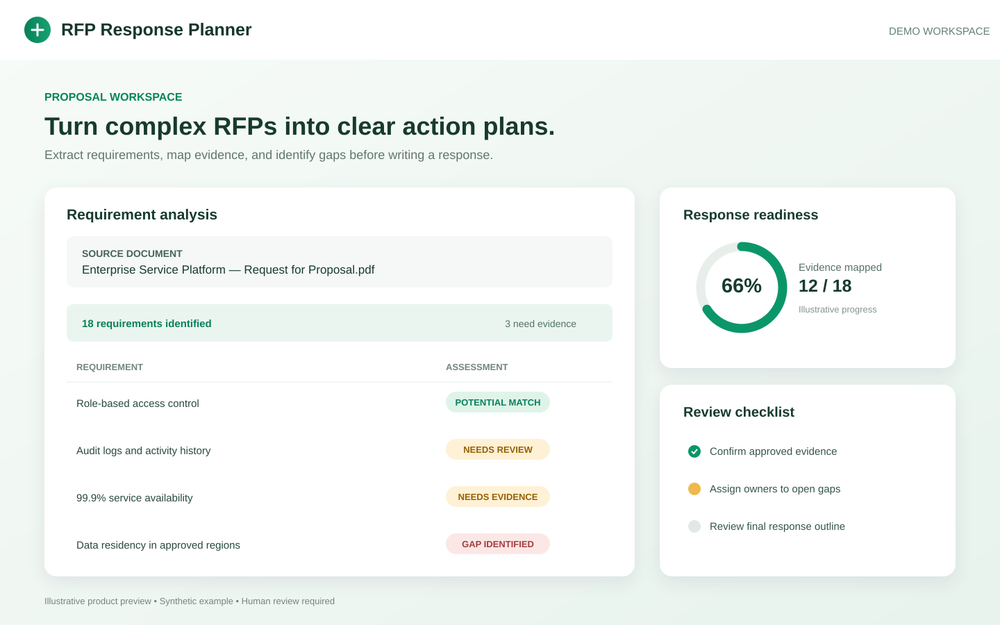
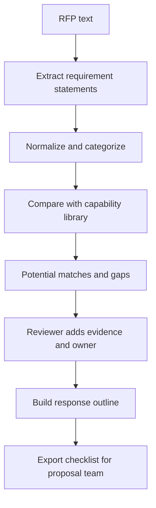

# AI RFP Response Planner

An AI-assisted RFP analysis workspace that turns lengthy request-for-proposal documents into structured requirements, evidence-mapping tasks, gap lists, and a response outline. It is designed to help proposal and sales teams organize their work before drafting a submission.

> **Demo scope:** This repository is a decision-support prototype. Requirement extraction and capability matching are indicative, not legal or contractual compliance determinations. Every match, claim, and final response must be verified by a human reviewer.

## Dashboard preview



*Illustrative interface concept showing requirement assessments, evidence coverage, and a human review checklist. It is a visual preview, not a captured running application.*

## Business scenario

A company receives a detailed RFP with technical, security, delivery, and operational requirements. The proposal team must understand every requirement, find approved evidence, identify unanswered questions, and coordinate owners before the submission deadline.

This demo is designed to help answer:

- What requirements does the RFP contain?
- Which requirements appear to match the company's stated capabilities?
- Where is supporting evidence missing or uncertain?
- Which items need a subject-matter expert or compliance review?
- What topics should be covered in the response outline?

## Features

- **Requirement extraction** from pasted RFP text into reviewable individual items.
- **Capability mapping** against a configurable set of illustrative company capabilities.
- **Gap identification** for requirements without a clear potential match.
- **Evidence and owner fields** so reviewers can attach proof and assign follow-up responsibility.
- **Response outline generation** organized around the extracted requirements.
- **CSV export** for sharing and tracking the requirement checklist.
- **Human-in-the-loop workflow**: potential matches are suggestions, not verified compliance statements.

## Workflow



## Quick start

The repository currently contains the project documentation and illustrative preview. Add the Streamlit application file (`app.py`) and dependency file (`requirements.txt`) to run the interactive prototype.

Once those files are present:

```bash
git clone https://github.com/HardikPaghdar/ai-rfp-response-planner.git
cd ai-rfp-response-planner
python -m venv .venv
source .venv/bin/activate
# Windows: .venv\\Scripts\\Activate.ps1
pip install -r requirements.txt
streamlit run app.py
```

## Intended application flow

1. Paste the RFP content into the workspace.
2. Extract requirement-like statements for review.
3. Compare each item with the illustrative capability library.
4. Review potential matches and flag gaps or uncertain items.
5. Add evidence notes and assign an owner to each requirement.
6. Generate a response outline and export the checklist.

## Assessment approach

The prototype's initial matching approach is deliberately transparent and lightweight: it compares requirement text with configured capability descriptions and surfaces possible matches for review.

A keyword or semantic match does **not** prove that a company meets a requirement. In particular, security certifications, uptime commitments, regulatory obligations, data residency, contractual terms, and customer references must be supported by current, approved evidence.

## Project structure

```text
app.py                         # Streamlit application (to be added)
requirements.txt               # Python dependencies (to be added)
docs/
  screenshots/
    rfp-planner-preview.svg    # Illustrative dashboard preview
```

## Safety, privacy, and limitations

- Use synthetic or appropriately sanitized RFP content in this demo.
- Do not upload confidential customer information, credentials, or restricted documents to unapproved services.
- Capability matches are suggestions and may be incomplete or incorrect.
- The demo does not validate certifications, legal clauses, security controls, SLAs, or contractual commitments.
- Never invent company experience, customer references, certifications, product features, or delivery guarantees.
- A qualified person must verify evidence and approve every response before submission.
- No RFP portal, CRM, document-management system, or proposal platform is connected.

## Implemented vs. possible extensions

**Documented prototype scope:** requirement checklist workflow, indicative capability mapping, evidence/owner review, response outline, and CSV export concept.

**Possible extensions:** PDF/DOCX ingestion, LLM-assisted extraction with source citations, requirement categorization, approved-answer library, evidence retrieval with RAG, role-based reviews, deadline tracking, version history, proposal templates, and integrations with CRM or document-management platforms.

## Related projects

- [AI Procurement & Supplier Risk Agent](https://github.com/HardikPaghdar/ai-procurement-supplier-risk-agent) — explainable decision support and human-reviewed action plans.
- [AI Document Intelligence & Extraction](https://github.com/HardikPaghdar/ai-document-intelligence-extraction) — structured extraction from business documents.
- [Legal AI Assistant](https://github.com/HardikPaghdar/Legal-AI-Assistant) — document-focused AI assistance.
- [More projects on my portfolio](https://hardikpaghdar.netlify.app/).

## License

MIT — see [LICENSE](LICENSE).
